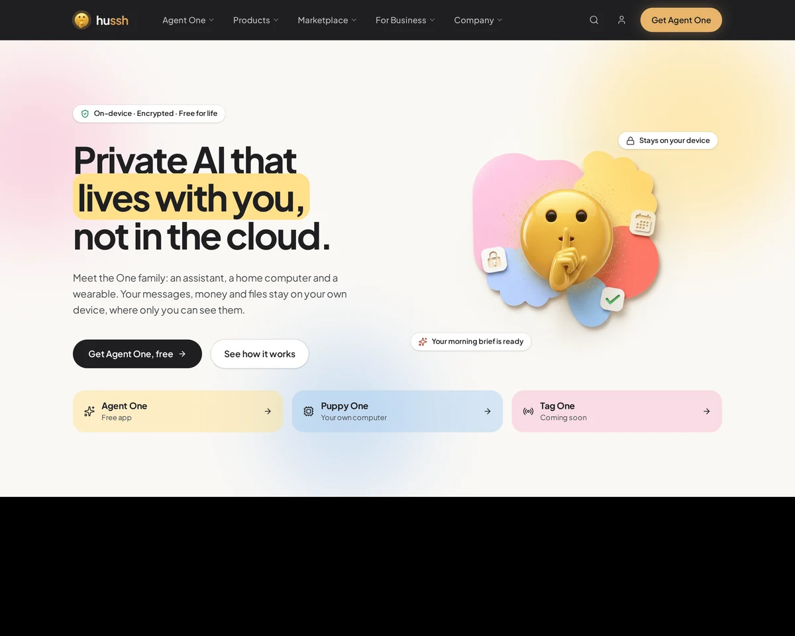

# hussh landing page redesign

A UX/UI case study redesigning the landing page of hussh, a privacy-first personal AI. It covers the full process: a heuristic audit of the live page, problem framing, wireframes and visual explorations, the design decision, UX copy, the final responsive design and an accessibility review.

**Case study:** https://samikshya109.github.io/hussh-landing-page-redesign/

**Live prototype:** https://hussh-prototype-vercel.vercel.app/



## The problem

The current homepage leads with "Personal supercomputing, owned by you." It describes a belief rather than the product. First-time visitors can't tell what Agent One does or how the three products relate, and the page ends without a call to action.

## The outcome

- A benefit-led hero: **"Private AI that lives with you, not in the cloud."**
- Agent One as the lead product, with Puppy One and Tag One supporting it
- Privacy shown, not just stated: a side-by-side comparison with typical cloud AI and a marketplace demo
- Nine call-to-action labels reduced to three clear intents, and a closing call to action
- Designed at 1440px desktop and 390px mobile
- Designed toward WCAG 2.2 AA: 0 contrast failures across 191 text elements in automated checks on the live build; manual keyboard and screen-reader testing is pending

## Prototype scope

- **Works:** page navigation and menus, the "How it works" step tour, selecting the four rings, and the responsive layout.
- **Mockups only:** email sign-up forms, "Get Agent One" and "Explore" buttons, and footer links. Nothing is submitted, downloaded or opened.
- **Illustrations:** the marketplace toggles, price slider and Approve/Decline controls show how the feature would work but aren't interactive.

Marketplace figures ($12 floor price, $57 earned) are illustrative, the two-minute setup time is proposed copy to confirm with hussh, and the cloud-AI comparison would need legal review before launch.

## What's in the case study

| # | Section | What it shows |
|---|---|---|
| 00 | Overview | A 60-second summary: the problem, three key decisions and results |
| 01 | Context | The three products, the audience and constraints |
| 02 | Audit | 20 heuristic findings pinned to screenshots of the live page |
| 03 | Framing | Problem statement, priorities, information architecture |
| 04 | Timeline & AI | The seven-phase process, what I did and what AI did |
| 05 | Explorations | Four wireframe directions and five visual directions |
| 06 | Decision | Weighted scoring and how the final combines the directions |
| 07 | UX copy | Headline testing, CTA consolidation, voice rules |
| 08 | Before & after | Swipe comparisons, annotations, claims and prototype scope |
| 09 | Responsive | Desktop and mobile layouts, section by section |
| 10 | Accessibility | WCAG 2.2 AA checks, token contrast and pending manual tests |
| 11 | Visual system | Color, type and components |
| 12 | Tradeoffs & next | Tradeoffs, a first-impression test plan and reflection |

## How AI was used

AI tools helped draft, generate wireframe and visual variations, build coded prototypes, and run accessibility checks. Problem framing, scoring, the choice of direction, copy and product accuracy were my decisions. The case study's timeline section shows where I overruled what the tools produced.

## Repository structure

```
index.html   The case study (a single self-contained page)
images/      Screenshots of the current site, explorations and final design
README.md
```

## Run it locally

No build step. Open `index.html` in a browser, or serve the folder:

```
python3 -m http.server
```

Then visit http://localhost:8000.

## Notes

- This is a design assessment, not an official hussh project. hussh names, the mascot and product imagery belong to hussh.
- Third-party AI names and logos appear only to show compatibility and belong to their owners.
- The outcomes listed are design intentions. No user research or conversion data informed this redesign; the case study includes a plan to validate it.

© 2026 Samikshya Satpathy. All rights reserved.
